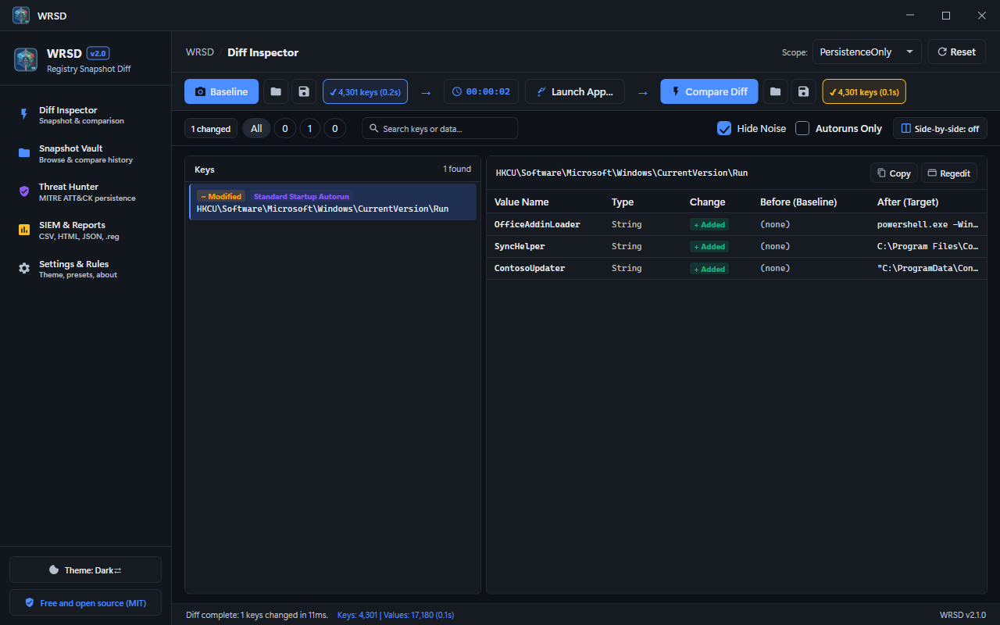
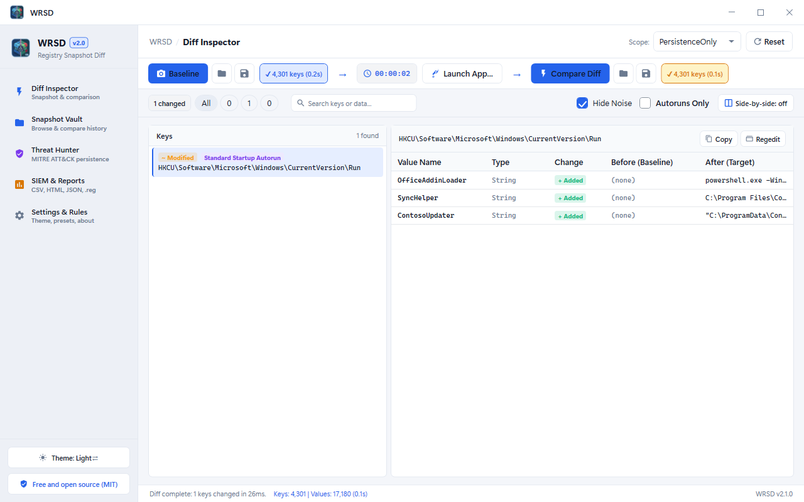

# WRSD — Windows Registry Snapshot Diff

A Windows desktop tool (**.NET 10 / WPF**) that captures the registry before and after you install software or change settings, shows exactly what changed (added, modified and deleted keys and values, side by side), flags malware persistence hooks with MITRE ATT&CK mapping, keeps a vault of snapshots, and exports reports for SIEM tools or a 1-click **undo `.reg`** script. A command-line tool (`wrsd-cli.exe`) does the same for scripts and pipelines.



<details><summary>Light theme</summary>



</details>

## Download

Get the installer from the [latest release](https://github.com/md-anamul-hasan/wrsd/releases/latest) (Windows 10/11, 64-bit; self-contained, no .NET install needed) and check it against `SHA256SUMS.txt`. Release builds are intended to be code-signed with a free certificate from the [SignPath Foundation](https://signpath.org/) (see [Code signing policy](#code-signing-policy)); until the project is approved, Windows SmartScreen may warn about an unknown publisher.

## What it does

| Area | Behaviour |
|---|---|
| Snapshots | Native registry enumeration with live progress and cancellation; compressed `.wrsd` files; scan presets: Quick Triage, Software only, System services, Persistence only, Full system |
| Diff Inspector | O(N) linear-time diff with instant search, added / modified / deleted filters and a side-by-side Before / After value inspector |
| Noise suppression | Hides Windows background churn (telemetry, search indexer, UserAssist MRU, certificate caches) so the diff shows what the installer really did |
| Threat Hunter | MITRE ATT&CK persistence triage: Run / RunOnce, services and drivers, IFEO debugger hijacks and Winlogon hooks, each with a remediation `.reg` |
| Snapshot Vault | Local repository (`Documents\WRSD\Snapshots`) to browse snapshots and compare any two of them |
| Exports | Undo and redo `.reg` scripts, CSV (Splunk / Elastic / Sentinel / Excel), styled HTML and JSON reports |
| Command line | `wrsd-cli.exe snapshot` and `diff` for scripts and pipelines (needs the shared .NET 10 runtime; Settings & Rules installs it with one click) |
| Other | Dark/light/system theme; run as Administrator to scan system (`HKLM`) keys |

### Command line

```
wrsd-cli snapshot baseline.wrsd --preset quick
wrsd-cli snapshot target.wrsd   --preset quick
wrsd-cli diff baseline.wrsd target.wrsd --undo-reg rollback.reg --html report.html
```
Run `wrsd-cli` without arguments for all options. Quick start: [docs/QUICKSTART.md](docs/QUICKSTART.md).


## Build, test, run

```powershell
dotnet build Wrsd.slnx
dotnet test  Wrsd.slnx

# Self-contained installer in dist\installer (needs Inno Setup 6: winget install JRSoftware.InnoSetup)
.\scripts\build-installer.ps1

# Installer plus SHA256SUMS.txt in dist\release, ready to upload
.\scripts\package-release.ps1
```

The version comes from `Directory.Build.props`. Building needs the .NET 10 SDK; the installed app needs nothing else.

## Layout

```
src/Wrsd.Core    scanning engine, diff, noise rules, triage, exporters, snapshot storage (no UI dependencies)
src/Wrsd.UI      WPF app (MVVM): MainWindow, MainViewModel, themes
src/Wrsd.Cli     headless snapshot / diff tool
tests/Wrsd.Tests xUnit: diff engine, classifiers, exporters, runtime detection
scripts/         build-installer.ps1, package-release.ps1, capture-media.ps1 (screenshots)
installer/       Inno Setup script
Directory.Build.props  single source of the product version
```

## Known limitations

- Scanning system (`HKLM`) keys needs Administrator rights; without them only what the account can read is captured.
- A diff reflects everything that changed between the two snapshots, so run it on a quiet machine; noise suppression removes common Windows churn but not all of it.
- The Full system preset is thorough but slow and produces large snapshots.
- `wrsd-cli.exe` needs the shared .NET 10 runtime.
- Windows 10 (21H2+) and Windows 11, 64-bit only.

## License

[MIT](LICENSE). Free for personal and commercial use.

## Code signing policy

Free code signing for release builds is provided by [SignPath.io](https://about.signpath.io/), with a certificate from the [SignPath Foundation](https://signpath.org/), once the project is approved.

- Releases are built and signed only by the GitHub Actions workflow `.github/workflows/release.yml` from tagged commits of this repository.
- Only WRSD's own binary and its installer are signed.
- Maintainer and approver: Md Anamul Hasan ([@md-anamul-hasan](https://github.com/md-anamul-hasan)).

## Privacy

Full policy: [docs/PRIVACY.md](docs/PRIVACY.md).

WRSD makes no network connections and has no telemetry or update check. Snapshots and settings stay on your machine.
